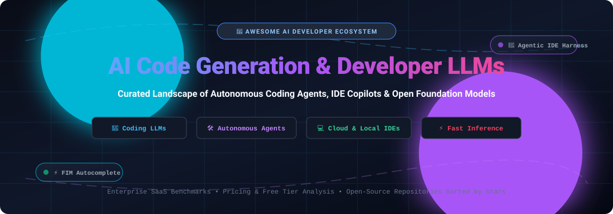

  

# 🚀 Awesome AI Code Generation & Developer LLMs

### 🌟 Curated List of SaaS Platforms, Agentic IDEs, Open-Source Coding LLMs & Dev Infrastructure

---

## 📖 Executive Summary & SEO Overview

Welcome to the definitive, search-optimized index tracking the rapidly evolving software engineering AI revolution. From foundational code generation models (**Qwen3-Coder**, **DeepSeek-Coder-V2**, **Codestral**, **StarCoder2**) and agentic IDE frameworks (**Cursor**, **Windsurf**, **GitHub Copilot**, **Devin Desktop**, **Cline**, **Aider**) to local high-throughput inference engines (**vLLM**, **llama.cpp**, **Ollama**), this guide catalogs both enterprise SaaS products and production-grade open-source repositories.

Whether you are looking to benchmark sub-second Fill-in-the-Middle (FIM) code completions, evaluate multi-file agentic refactoring harnesses, audit zero-data-retention compliance, or run private offline coding LLM pipelines on consumer GPUs, this repository provides verified data, real-time GitHub metrics, and transparent SaaS pricing.

---

## 📑 Table of Contents

- [📊 Sector Overview & Market Dynamics](#-sector-overview--market-dynamics)
- [💼 SaaS/Hosted Platforms](#-saashosted-platforms)
- [🔓 Open-Source GitHub Projects](#-open-source-github-projects)
  - [⭐ Open-Source Ecosystem (Ranked by Stars)](#-open-source-ecosystem-ranked-by-stars)
  - [🔬 Rigorous Benchmarks & Evaluation Harnesses](#-rigorous-benchmarks--evaluation-harnesses)
  - [📚 Open Pretraining Datasets & Fine-Tuning Toolkits](#-open-pretraining-datasets--fine-tuning-toolkits)
- [📈 Star History](#-star-history)
- [💖 Support & Sponsorship](#-support--sponsorship)
- [🤝 How to Contribute](#-how-to-contribute)
- [⚖️ License & Disclaimer](#-license--disclaimer)

---

## 📊 Sector Overview & Market Dynamics

The global AI code generation and developer assistant market is valued at approximately **$16.1 billion in 2026** (scaling from ~$8–$11.8B in 2025) and is projected to expand to between **$62 billion and $127 billion by the early 2030s**, compounding at an extraordinary **CAGR of 35% to 48%**. 

The sector is **moderately fragmented yet increasingly bifurcated into a high-stakes, winner-takes-most consolidation at the top**: hyper-scalers (Microsoft/GitHub, Amazon, Alphabet) and breakout agentic unicorns (Cursor/Anysphere, Replit, Cognition/Windsurf) command dominant enterprise mindshare and massive venture funding, while an aggressive, open-source ecosystem (Ollama, vLLM, Cline, Qwen-Code, OpenHands) prevents closed-source monopolization by empowering organizations to self-host sovereign, zero-data-retention coding agents.

---

## 💼 SaaS/Hosted Platforms

The table below catalogs premier commercial AI code generation platforms and agentic developer environments. Companies are **sorted in descending order by enterprise market size / corporate valuation / annual revenue run-rate**.

| Company / Product | Company Size (Valuation / Revenue) | Starting Paid Pricing | Free Tier / Free Trial Limits | Key Capabilities & Architecture |
| :--- | :--- | :--- | :--- | :--- |
| **[Amazon Q Developer](https://aws.amazon.com/q/developer/)** | **~$2.2 Trillion** *(Amazon Market Cap)* | **$19 / user / month** *(Pro Plan)* | **Perpetual Free Tier**: 50 agentic requests/month, 1,000 lines Java code transformation/month, 50 security scans/month. | Deep AWS infrastructure context, automated Java version upgrades, multi-file software engineering tasks, and native CLI/IDE integrations. |
| **[JetBrains AI Assistant & Junie](https://www.jetbrains.com/ai/)** | **~$700M ARR** *(Privately held & profitable)* | **$10 / month** *(or $100/year for AI Pro)* | **Perpetual Free Plan** (basic Mellum code completion & local Ollama models) + **30-day Free Trial** of AI Pro with cloud LLM quota. | Deeply native AST-level integration into IntelliJ, PyCharm, WebStorm, and Rider; supports hybrid local model routing and autonomous tasks via Junie. |
| **[Cursor](https://www.cursor.com)** | **$60 Billion** *(Acquired by SpaceX; $4B+ ARR)* | **$20 / month** *(Pro Plan; $8/mo Plus)* | **Free Hobby Plan**: Limited monthly requests across Tab, Chat, and Agent; subject to slow standard queue during peak hours. | AI-native VS Code fork with predictive multi-token Tab completion, 1M+ token context indexing, Composer multi-file agent, and background cloud agents. |
| **[Anthropic Claude Code](https://claude.com)** | **$60 Billion** *(Venture Valuation)* | **$20 / month** *(Claude Pro; also pay-as-you-go API)* | **Free Tier**: No Claude Code CLI access (Web Claude free tier has strict rolling 5-hour message limits; Claude Code requires Pro, Max, or API credits). | Frontier reasoning agent running in the terminal with full bash execution, tool calling, Git worktree orchestration, and high SWE-bench benchmark ratings. |
| **[GitHub Copilot](https://github.com/features/copilot)** | **$7.5 Billion** *(Acquired by Microsoft / GitHub division; $2B+ ARR)* | **$10 / month** *(or $100/yr for Copilot Individual / Pro)* | **Copilot Free Plan**: 2,000 code completions per month and 50 chat messages per month (no credit card required). | Industry pioneer with inline FIM autocomplete, multi-model selection (GPT, Claude, Gemini), automated Copilot Workspace PR reviews, and IP indemnity. |
| **[Replit Agent](https://replit.com)** | **$9 Billion** *(Series D Valuation)* | **$20 / month** *(Replit Core billed annually; or $25/mo)* | **Starter Free Plan**: 1 published app limit, 1,200 dev minutes/month, limited daily Free Mode AI agent queries, shared 512MB RAM compute. | Cloud-native collaborative IDE and full-stack autonomous software generation agent turning conversational natural language into live deployed web apps. |
| **[Windsurf (formerly Codeium)](https://windsurf.com)** | **$2.4 Billion** *(Google talent deal & Cognition/Devin Desktop)* | **$20 / month** *(Windsurf Pro)* | **Free Tier**: Unlimited fast Tab code autocompletions; light quota of ~25 Cascade agent flow actions/month (SWE-mini models). | Cascade collaborative flow architecture connecting inline edits, multi-file code editing, integrated terminal execution, and deep codebase indexation. |
| **[Sourcegraph Cody](https://sourcegraph.com/cody)** | **$2.625 Billion** *(Series D Valuation)* | **$19 / user / month** *(Cody Enterprise starting base)* | **Enterprise Free Trial**: 14-day to 30-day corporate pilot trial upon request (individual Cody Free plan discontinued). | Multi-repository code search, enterprise Code Graph RAG indexing, inline codebase context generation, and custom LLM gateway connections. |
| **[Tabnine](https://www.tabnine.com)** | **~$55M+ Funding / Acquired by Tricentis** *(~$27M ARR)* | **$39 / user / month** *(Code Assistant Plan, annual billing)* | **No Perpetual Free Tier**: Offers 14-day to 90-day guided enterprise team proof-of-concept trial upon request. | Zero-data-retention security focus, air-gapped VPC on-premise deployments, custom enterprise repository fine-tuning, and strict licensing compliance. |
| **[Supermaven](https://supermaven.com)** | **$12M Seed / Acquired by Anysphere (Cursor)** | **$10 / month** *(Pro Plan)* | **Free Forever Plan**: Sub-second fast inline code completions with a 7-day data retention limit (1M token context reserved for Pro). | Ultra-low latency code completion engine powered by the proprietary 1,000,000-token Babble model architecture for instant repository-wide predictions. |

---

## 🔓 Open-Source GitHub Projects

The open-source ecosystem delivers sovereign foundation models, developer CLIs, terminal pair-programmers, and high-performance inference servers. 

### ⭐ Open-Source Ecosystem (Ranked by Stars)

All repositories are actively maintained and sorted in **descending order by GitHub stargazers count**. Each badge is dynamically linked to the respective repository's stargazers page:

1. **[Ollama](https://github.com/ollama/ollama)**   
   ⚡ *187,000+ stars* • `MIT License`  
   The premier CLI and desktop runner to pull, quantize, and execute open-weight coding models (`Qwen3-Coder`, `DeepSeek-Coder-V2`, `Codestral`) locally on macOS, Linux, and Windows via an OpenAI-compatible API.

2. **[llama.cpp](https://github.com/ggml-org/llama.cpp)**   
   ⚡ *135,000+ stars* • `MIT License`  
   High-performance, zero-dependency C/C++ LLM inference engine supporting 1.5-bit to 8-bit GGUF quantization of coding foundation models across CPU, Apple Metal, NVIDIA CUDA, AMD ROCm, and Vulkan.

3. **[vLLM](https://github.com/vllm-project/vllm)**   
   ⚡ *97,000+ stars* • `Apache-2.0 License`  
   High-throughput enterprise inference and serving engine utilizing PagedAttention, speculative decoding, and prefix caching for low-latency team code generation and autocomplete APIs.

4. **[OpenHands](https://github.com/All-Hands-AI/OpenHands)**   
   ⚡ *93,000+ stars* • `MIT License`  
   Open-source platform for autonomous software engineering agents running inside isolated Docker containers with full terminal bash, code editing, and headless web browser inspection.

5. **[Unsloth](https://github.com/unslothai/unsloth)**   
   ⚡ *79,000+ stars* • `Apache-2.0 License`  
   Ultra-fast 2x–5x accelerated fine-tuning and LoRA/QLoRA training harness with 80% reduced VRAM consumption for adapting open coding models to custom internal codebases.

6. **[LLaMA-Factory](https://github.com/hiyouga/LLaMA-Factory)**   
   ⚡ *76,000+ stars* • `Apache-2.0 License`  
   Unified visual fine-tuning suite supporting 100+ open-source LLMs/VLMs with distributed training (DeepSpeed, FSDP), DPO, ORPO, and specialized code instruction datasets.

7. **[Cline](https://github.com/cline/cline)**   
   ⚡ *71,000+ stars* • `Apache-2.0 License`  
   Autonomous coding agent inside VS Code capable of multi-file refactoring, terminal execution, and browser inspection with Model Context Protocol (MCP) tool integration.

8. **[LiteLLM](https://github.com/BerriAI/litellm)**   
   ⚡ *63,000+ stars* • `MIT License`  
   Lightweight, high-speed proxy gateway that translates 100+ LLM APIs into standard OpenAI format with load balancing, rate limiting, and fallbacks for developer coding agents.

9. **[gpt-engineer](https://github.com/AntonOsika/gpt-engineer)**   
   ⚡ *54,000+ stars* • `MIT License`  
   CLI and open-source platform that generates entire software codebases from high-level natural language prompt specifications (the open-source foundation behind Lovable).

10. **[Aider](https://github.com/Aider-AI/aider)**   
    ⚡ *50,000+ stars* • `Apache-2.0 License`  
    Pioneering terminal pair-programming assistant that maps Git codebases with tree-sitter, coordinates edits across multiple files, executes unit tests, and commits clean Git diffs.

11. **[Continue](https://github.com/continuedev/continue)**   
    ⚡ *36,000+ stars* • `Apache-2.0 License`  
    The leading open-source AI code extension for VS Code and JetBrains enabling customizable tab autocomplete, chat, and agentic workflows backed by any local or cloud LLM.

12. **[Tabby](https://github.com/TabbyML/tabby)**   
    ⚡ *33,000+ stars* • `Apache-2.0 License`  
    Self-hosted AI coding assistant written in Rust with local repository indexing, FIM code completion, and IDE extensions for VS Code, IntelliJ, and Vim/Neovim.

13. **[Qwen Code](https://github.com/QwenLM/qwen-code)**   
    ⚡ *30,000+ stars* • `Apache-2.0 License`  
    Official open-source terminal coding assistant and developer harness from Alibaba Qwen, tailored for `Qwen3-Coder` with repo-wide context and MCP server integration.

14. **[Void](https://github.com/voideditor/void)**   
    ⚡ *28,000+ stars* • `Apache-2.0 License`  
    Open-source alternative to Cursor built on VS Code, delivering full user privacy, local vector indexing, inline diff suggestions, and seamless custom model connections.

15. **[Roo Code](https://github.com/RooCodeInc/Roo-Code)**   
    ⚡ *24,000+ stars* • `Apache-2.0 License`  
    Community-driven agentic VS Code extension with customizable specialist modes (Architect, Coder, Debugger), custom MCP tools, and autonomous multi-file generation.

16. **[Qwen2.5-Coder & Qwen3-Coder](https://github.com/QwenLM/Qwen2.5-Coder)**   
    ⚡ *16,800+ stars* • `Apache-2.0 License`  
    State-of-the-art open-source code LLM family (0.5B to 32B+ parameters) excelling across code generation, automated debugging, and 128K-context repository comprehension.

17. **[PR-Agent](https://github.com/The-PR-Agent/pr-agent)**   
    ⚡ *16,300+ stars* • `Apache-2.0 License`  
    Autonomous open-source AI pull request reviewer and documentation generator providing automated reviews, inline PR suggestions, changelogs, and security scanning.

18. **[Code Llama](https://github.com/meta-llama/codellama)**   
    ⚡ *16,200+ stars* • `Custom Commercial License`  
    Meta's foundational code-specialized family (7B, 13B, 34B, 70B) featuring dedicated Python and Instruct variants with native Fill-in-the-Middle (FIM) autocomplete.

19. **[Mistral Codestral & Devstral](https://github.com/mistralai/mistral-inference)**   
    ⚡ *10,800+ stars* • `MNCL / Apache-2.0 License`  
    High-speed open-weight coding and software agent models designed by Mistral AI with 256K context support, fast FIM inference, and multi-file code editing.

20. **[Sweep](https://github.com/sweepai/sweep)**   
    ⚡ *7,700+ stars* • `Apache-2.0 License`  
    AI-powered developer assistant for JetBrains and GitHub issues that converts bug reports and feature requests directly into tested pull requests.

21. **[DeepSeek-Coder-V2](https://github.com/deepseek-ai/DeepSeek-Coder-V2)**   
    ⚡ *7,000+ stars* • `DeepSeek License (Permissive)`  
    Open-source Mixture-of-Experts (MoE) coding model with 16B active / 236B total parameters, matching frontier proprietary models across 338 programming languages.

22. **[OpenCoder](https://github.com/OpenCoder-llm/OpenCoder-llm)**   
    ⚡ *2,100+ stars* • `Apache-2.0 License`  
    Fully transparent and reproducible open-source code LLM releasing data filtering recipes, synthetic instruction datasets, and intermediate training checkpoints.

23. **[StarCoder2](https://github.com/bigcode-project/starcoder2)**   
    ⚡ *2,000+ stars* • `OpenRAIL-M v1 License`  
    Community-developed code LLM family (3B, 7B, 15B) trained by BigCode and ServiceNow on The Stack v2 spanning 600+ programming languages.

24. **[Seed-Coder](https://github.com/ByteDance-Seed/Seed-Coder)**   
    ⚡ *760+ stars* • `MIT License`  
    ByteDance's open-source 8B coding model family comprising Base, Instruct, and Reasoning checkpoints optimized for competitive synthesis and debugging benchmarks.

---

### 🔬 Rigorous Benchmarks & Evaluation Harnesses

Standardized benchmarks for evaluating LLM code generation, reasoning, and real-world SWE issue fixing:

* **[EvalPlus (`evalplus/evalplus`)](https://github.com/evalplus/evalplus)**  — Rigorous evaluation framework augmenting `HumanEval` and `MBPP` with 80x more test cases (`HumanEval+`, `MBPP+`) to detect subtle logical errors.
* **[LiveCodeBench (`LiveCodeBench/LiveCodeBench`)](https://github.com/LiveCodeBench/LiveCodeBench)**  — Contamination-free benchmark continuously harvesting real-world coding problems from LeetCode, AtCoder, and Codeforces competitions.
* **[BigCode Evaluation Harness (`bigcode-project/bigcode-evaluation-harness`)](https://github.com/bigcode-project/bigcode-evaluation-harness)**  — Unified framework for testing autoregressive coding models on MultiPL-E, DS-1000, and APPS.

---

### 📚 Open Pretraining Datasets & Fine-Tuning Toolkits

* **[The Stack v2 (`bigcode-project/the-stack-v2`)](https://huggingface.co/datasets/bigcode/the-stack-v2)** — Over 3 billion files with 600+ languages, strict license attribution, and Software Heritage archival backing.
* **[OpenCodeInstruct (`nvidia/OpenCodeInstruct`)](https://huggingface.co/datasets/nvidia/OpenCodeInstruct)** — High-quality synthetic multi-turn coding instructions curated for instruction-tuning and alignment.

---

## 📈 Star History

---

## 💖 Support & Sponsorship

If you find this ecosystem map helpful for your development workflow, research, or enterprise tooling decisions, please consider supporting the project:

- ⭐ **Star this repository** to help others discover it on GitHub!
- 🍴 **Fork the repo** to contribute additions, benchmarks, or tool updates.
- 📣 **Share with your developer community**, AI teams, or on social channels.
- ☕ **Buy me a coffee & support ongoing research**: Check out the [GitHub Sponsor Dashboard](https://github.com/sponsors/ishandutta2007) to keep this index continuously updated.

---

## 🤝 How to Contribute

Contributions are welcome from the global developer community!
1. Fork this repository.
2. Create a new branch (`git checkout -b feature/add-new-tool`).
3. Add your tool, open-weight model, or benchmark. Ensure descriptions remain objective, technical, and include license terms.
4. If submitting a SaaS product, include verified pricing and free tier/trial limits in the tabular format.
5. Submit a Pull Request with a clear description of the project.

---

## ⚖️ License & Disclaimer

- **License**: Creative Commons Zero v1.0 Universal (`CC0-1.0`).
- **Disclaimer**: All product names, logos, and brands are property of their respective owners. Pricing tiers, trial conditions, and model performance metrics are subject to continuous updates by their creators.
